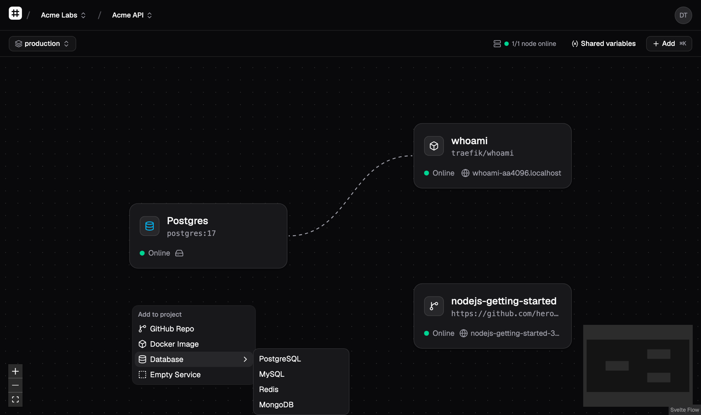
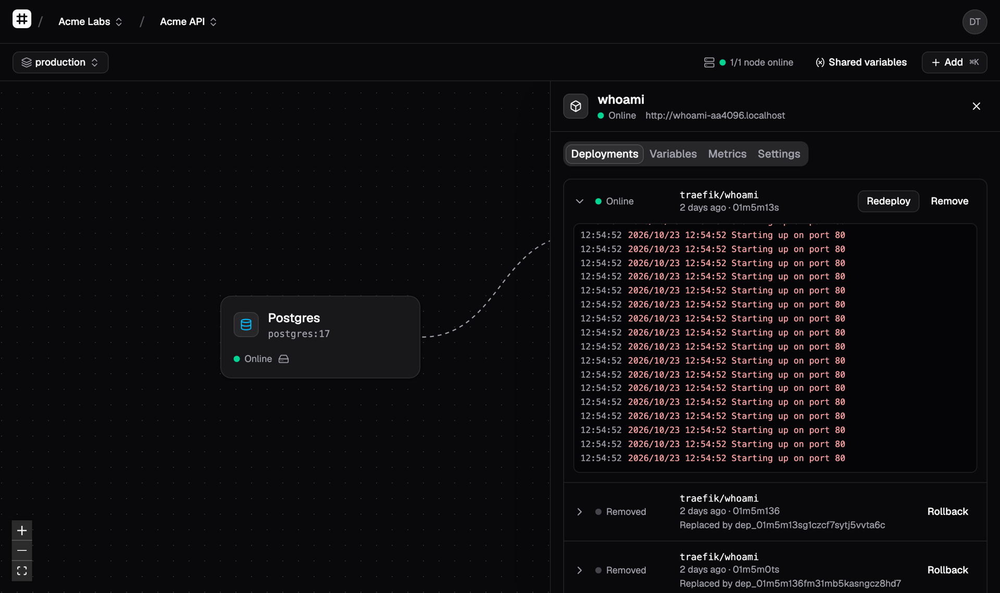
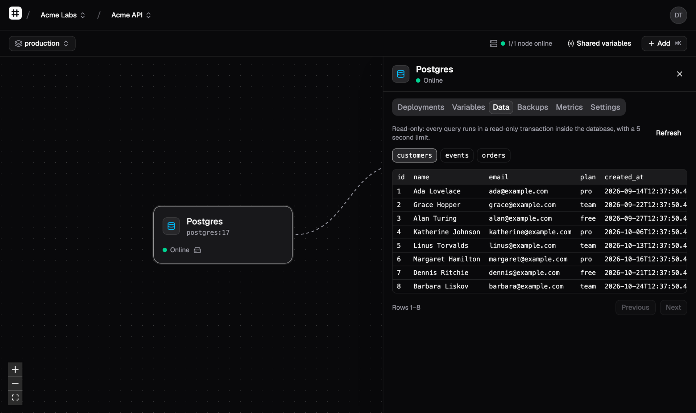
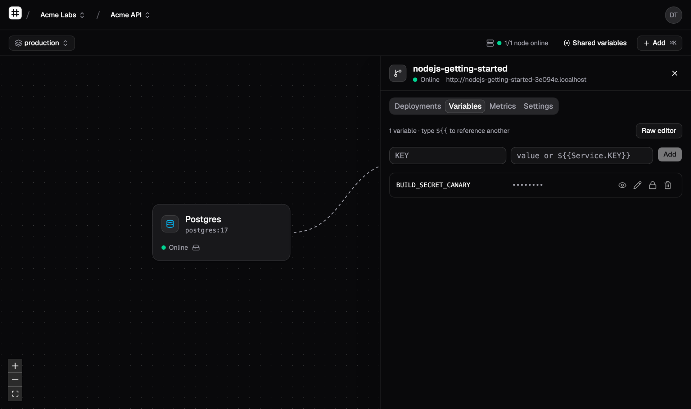
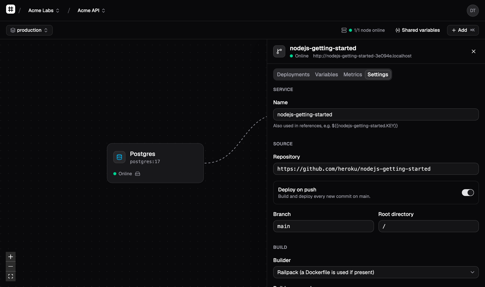
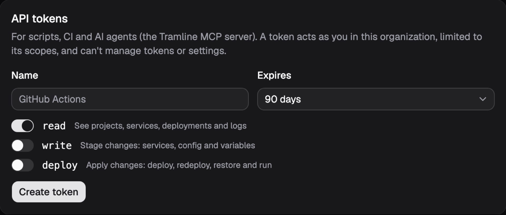

<div align="center">

<picture>
  <source media="(prefers-color-scheme: dark)" srcset="docs/images/logo-dark.svg">
  
</picture>

# Tramline

**The deploy experience you love, on infrastructure you own.**

An open-source, self-hosted platform inspired by [Railway](https://railway.com). Draw your stack on a canvas, push to deploy, and keep your code, secrets and data on hardware you control.

[](https://github.com/JTCorrin/tramline/actions/workflows/ci.yml)
[](https://github.com/JTCorrin/tramline/actions/workflows/security.yml)
[](LICENSE)
[](docs/roadmap.md)
[](CONTRIBUTING.md)

[Why Tramline](#why-tramline) · [Tour](#a-quick-tour) · [Get started](#get-started) · [Add machines](#add-machines) · [Roadmap](#roadmap) · [Contributing](#contributing)

<br>



</div>

<br>

## Why Tramline

Platforms like Railway made deploying feel effortless: a canvas instead of YAML, a database in two clicks, a URL on every push. But your code, your customers' data and your secrets live on someone else's machines, and you pay their prices. Tramline brings that experience home.

<table>
<tr>
<td width="33%" valign="top">

### 🔒 Private

Your code, data and secrets never leave your infrastructure. Run it on a laptop, a homelab or your own servers. No telemetry, no vendor lock-in.

</td>
<td width="33%" valign="top">

### 🛡️ Secure by default

The safe choice is the default. Secrets are encrypted at rest, containers are locked down, builds are rootless, every image is scanned for vulnerabilities, and backups are encrypted before they leave the node.

</td>
<td width="33%" valign="top">

### ⚡ Actually pleasant

A real canvas, live logs, zero-downtime deploys, push-to-deploy from GitHub, one-click databases, and a data browser. All the comfort of a hosted platform.

</td>
</tr>
</table>

## A quick tour

<table>
<tr>
<td width="50%" valign="top">

**Deploy anything, watch it live**<br>
Builds from a GitHub repo (no Dockerfile needed, thanks to [Railpack](https://railpack.com)) or any Docker image. Logs stream in as it happens, and every old deployment is a one-click rollback.



</td>
<td width="50%" valign="top">

**Look inside your database**<br>
Postgres, MySQL, Redis and MongoDB in a click, each with a volume and generated credentials. Browse your Postgres tables right in the panel, read-only by construction.



</td>
</tr>
<tr>
<td width="50%" valign="top">

**Variables that connect your stack**<br>
Reference one service from another with `${{Postgres.DATABASE_URL}}` and the canvas draws the connection for you. Values are encrypted, and sealed variables can be written but never read back.



</td>
<td width="50%" valign="top">

**Push to deploy**<br>
Connect GitHub once, then every push to your branch ships. Watch paths skip rebuilds that don't matter, and changes are staged so you review them before they go out.



</td>
</tr>
</table>

### Built for AI agents too

Tramline ships an [MCP](https://modelcontextprotocol.io) server, so Claude, Cursor and other agents can inspect your projects, read logs and deploy. Each agent's access is limited to the scopes of its token, and everything it does is recorded in the audit log.

```bash
claude mcp add tramline --transport http https://tramline.example.com/mcp \
  --header "Authorization: Bearer tl_…"
```

<p align="center"></p>

## Everything in the box today

| Area           | What you get                                                                                                          |
| -------------- | --------------------------------------------------------------------------------------------------------------------- |
| **Canvas**     | Projects as a live canvas of services, environments (with one-click duplication), shared variables and staged changes |
| **Deploys**    | Docker images or builds from Git (Railpack or Dockerfile), zero-downtime swaps, rollbacks, cron services              |
| **Networking** | Automatic URLs through a Caddy ingress, custom domains with verified ownership and automatic HTTPS                    |
| **Data**       | Postgres, MySQL, Redis and MongoDB templates, persistent volumes, a read-only Postgres data browser                   |
| **Backups**    | Encrypted backups to any S3-compatible bucket with restore drills, including Tramline's own database                  |
| **Security**   | Encrypted secrets, hardened containers, rootless builds, Trivy image scanning, CSP, 2FA and passkeys                  |
| **Automation** | REST API, scoped API tokens, an audit log, an MCP server, and GitHub Actions deploys with no stored secrets (OIDC)    |

Want the details? [SECURITY.md](SECURITY.md) explains exactly how each protection works.

## Get started

> [!WARNING]
> Tramline is **pre-alpha**. It works well on a single machine today, but expect rough edges and breaking changes. Please don't run production workloads on it yet.

You'll need Node 24, pnpm 10 and Docker (Docker Desktop, OrbStack or Colima).

```bash
git clone https://github.com/JTCorrin/tramline.git && cd tramline
pnpm install
cp apps/web/.env.example apps/web/.env   # set TRAMLINE_SECRET_KEY: openssl rand -base64 32
pnpm dev
```

Open **http://localhost:5173**, create an account, right-click the canvas and deploy your first service. It'll be live at `http://<service>-<id>.localhost` within moments.

## Add machines

Tramline runs on one machine out of the box. To add more, connect a provider and Tramline creates the machines for you. Each one boots, installs Docker and joins on its own. Removing a node deletes its machine. Each guide below stands alone; pick yours.

<details>
<summary><strong>Proxmox VE</strong>: VMs on your own cluster (about 15 minutes)</summary>

<br>

**You need:** shell access to a Proxmox host, and Tramline running where the new VMs can reach it.

**1. Make a cloud-init template.** On the Proxmox host (change `local-lvm` and `vmbr0` if yours differ):

```sh
wget https://cloud.debian.org/images/cloud/bookworm/latest/debian-12-genericcloud-amd64.qcow2
qm create 9000 --name debian-12-cloud --memory 2048 --cores 2 \
  --net0 virtio,bridge=vmbr0 --scsihw virtio-scsi-pci
qm set 9000 --scsi0 local-lvm:0,import-from=$PWD/debian-12-genericcloud-amd64.qcow2
qm set 9000 --ide2 local-lvm:cloudinit --boot order=scsi0 \
  --serial0 socket --vga serial0 --ipconfig0 ip=dhcp
qm resize 9000 scsi0 +30G
qm template 9000
```

**2. Create an API token.** Still on the host:

```sh
pveum role add TramlineProvisioner -privs "VM.Allocate VM.Clone VM.Audit \
  VM.Config.CPU VM.Config.Memory VM.Config.Options VM.Config.HWType VM.Config.Disk \
  VM.PowerMgmt Datastore.AllocateSpace Datastore.Audit Sys.Audit SDN.Use"
pveum user add tramline@pve
pveum aclmod / -user tramline@pve -role TramlineProvisioner
pveum user token add tramline@pve tramline --privsep 0
cat /etc/pve/pve-root-ca.pem
```

Keep the token's value, which is shown once, and the certificate that `cat` prints.

**3. Let the VMs reach Tramline.** VMs can't reach `localhost`. Run Tramline on a LAN address (with the dev server, add `--host`), and set `TRAMLINE_AGENT_URL=http://<lan-ip>:5173` in `apps/web/.env`. **Nodes → Public access** then shows that address.

**4. Connect the account.** Go to **Nodes → Compute accounts → Connect an account → Proxmox VE**:

| Field            | Value                                                           |
| ---------------- | --------------------------------------------------------------- |
| Proxmox URL      | `https://<host>:8006`, using the name on the host's certificate |
| API token ID     | `tramline@pve!tramline`                                         |
| API token secret | the value from step 2                                           |
| CA certificate   | the PEM from step 2                                             |
| Template VM ID   | `9000`                                                          |

Click **Connect**, then **Test connection**. It should say _connected_.

**5. Add a node.** Under **Add a node**, set **Machine** to _New machine on (your account)_, name it, pick a host under **Region** and **Small** under **Size**, then **Create machine**. It shows _Waiting to enroll_ and joins the node list within a few minutes.

**6. Clean up.** Click **Remove** on the node. Tramline destroys the VM. It only ever destroys VMs tagged `tramline`.

**If it goes wrong**

- _The test fails on the certificate:_ the URL's hostname must match the certificate. Try the host's name instead of its IP.
- _Stuck on Waiting to enroll:_ open the VM's console in Proxmox. Usually it got no IP address, or it can't reach the address from step 3.

More: [docs/adapters/proxmox.md](docs/adapters/proxmox.md)

</details>

<details>
<summary><strong>Google Cloud</strong>: Compute Engine VMs (about 10 minutes)</summary>

<br>

**You need:** a Google Cloud project with billing turned on. One `e2-micro` in `us-central1`, `us-east1` or `us-west1` is free.

**1. Turn on Compute Engine.** In the console, go to **APIs & Services → Library**, search for _Compute Engine API_, and click **Enable**.

**2. Create a service account key.**

1. Go to **IAM & Admin → Service Accounts → Create service account** and name it `tramline`.
2. Give it two roles: **Compute Instance Admin (v1)** and **Compute Security Admin**.
3. Open the account, then **Keys → Add key → Create new key → JSON**. A file downloads.

**3. Let the VMs reach Tramline.** VMs join over the internet. If Tramline has a public HTTPS address, set `TRAMLINE_AGENT_URL` to it. At home, use **Nodes → Public access → Set up a Cloudflare tunnel** instead. Either way, that card should then show a public address.

**4. Connect the account.** Go to **Nodes → Compute accounts → Connect an account → Google Cloud**. Load the JSON file into **Service account key (JSON)** and leave the rest as it is. Click **Connect**, then **Test connection**. Then delete the downloaded file.

**5. Add a node.** Under **Add a node**, set **Machine** to _New machine on (your account)_, name it, pick **us-central1** and **e2-micro**, then **Create machine**. It joins the node list within a few minutes. In the console it appears under **Compute Engine → VM instances** with the label `tramline=node`.

**6. Clean up.** Click **Remove** on the node. Tramline deletes the VM and its disk. The firewall rule `tramline-mesh-default` stays; it costs nothing.

**If it goes wrong**

- _"Compute Engine API has not been used":_ do step 1, then wait a minute.
- _Key creation is blocked:_ your organization enforces `iam.disableServiceAccountKeyCreation`. An organization admin can lift it for the project.
- _A zone is out of capacity:_ Tramline tries the region's other zones. If they're all full, pick another region.

More: [docs/adapters/gcp.md](docs/adapters/gcp.md)

</details>

<details>
<summary><strong>Microsoft Azure</strong>: Azure VMs (about 15 minutes)</summary>

<br>

**You need:** an Azure subscription. A new account's first year includes a free `Standard_B1s`.

**1. Register an app.**

1. Go to **Microsoft Entra ID → App registrations → New registration**, name it `tramline`, and click **Register**. It needs no redirect URI.
2. On its overview page, copy the **Application (client) ID** and the **Directory (tenant) ID**.
3. Under **Certificates & secrets → New client secret**, add a secret and copy its **Value**. It's shown once; the _Secret ID_ is not what you want.

**2. Give it access.** Go to **Subscriptions → (yours)**, copy the **Subscription ID**, then open **Access control (IAM) → Add → Add role assignment**. On the **Privileged administrator roles** tab, choose **Contributor**, select the `tramline` app as the member, and save.

**3. Let the VMs reach Tramline.** VMs join over the internet. If Tramline has a public HTTPS address, set `TRAMLINE_AGENT_URL` to it. At home, use **Nodes → Public access → Set up a Cloudflare tunnel** instead. Either way, that card should then show a public address.

**4. Connect the account.** Go to **Nodes → Compute accounts → Connect an account → Microsoft Azure**, and fill in the tenant ID, client ID, client secret and subscription ID. Leave the rest as it is. Click **Connect**, then **Test connection**.

**5. Add a node.** Under **Add a node**, set **Machine** to _New machine on (your account)_, name it, pick a region such as **eastus (East US)** and the **Standard_B1s** size, then **Create machine**. It joins the node list within a few minutes. In the portal, everything is in the resource group `tramline`.

**6. Clean up.** Click **Remove** on the node. Tramline deletes the VM, its disk, network interface and public IP. The region's network and security group stay; they cost nothing.

**If it goes wrong**

- _"not registered to use namespace":_ under **Subscription → Resource providers**, register **Microsoft.Compute** and **Microsoft.Network**.
- _Authorization failed:_ the role assignment in step 2 is missing, or hasn't applied yet. It can take a few minutes.
- _Quota or SKU not available:_ pick another size or region, or request more under **Subscription → Usage + quotas**.

More: [docs/adapters/azure.md](docs/adapters/azure.md)

</details>

<details>
<summary><strong>Amazon Web Services</strong>: EC2 instances (about 10 minutes)</summary>

<br>

**You need:** an AWS account. A `t3.micro` is free-tier eligible.

**1. Create a policy.** Go to **IAM → Policies → Create policy → JSON**. Paste [this policy](docs/adapters/aws.md#2-an-access-key) and name it `tramline-nodes`. It lets the key start and terminate only instances tagged `tramline=node`.

**2. Create a user and key.**

1. Go to **IAM → Users → Create user**, name it `tramline`, give it no console access, and attach `tramline-nodes`.
2. Open the user, then **Security credentials → Create access key → Application running outside AWS**.
3. Copy the **access key ID** and the **secret access key**. The secret is shown once.

**3. Let the instances reach Tramline.** Instances join over the internet. If Tramline has a public HTTPS address, set `TRAMLINE_AGENT_URL` to it. At home, use **Nodes → Public access → Set up a Cloudflare tunnel** instead. Either way, that card should then show a public address.

**4. Connect the account.** Go to **Nodes → Compute accounts → Connect an account → Amazon Web Services**, and enter the key ID and secret. Click **Connect**, then **Test connection**.

**5. Add a node.** Under **Add a node**, set **Machine** to _New machine on (your account)_, name it, pick a region such as **us-east-1** and **t3.micro**, then **Create machine**. It joins the node list within a few minutes. In the console it appears under **EC2 → Instances** with the tag `tramline=node`.

**6. Clean up.** Click **Remove** on the node. Tramline terminates the instance, which deletes its disk. The security group `tramline-mesh` stays; it costs nothing.

**If it goes wrong**

- _"isn't authorized" (UnauthorizedOperation):_ the policy isn't attached to the user, or was changed.
- _Region not offered:_ only regions enabled for the account appear. Enable more under **Account → AWS Regions**.
- _vCPU limit exceeded:_ new accounts have a small quota. Pick a smaller size, or request more under **Service Quotas → Amazon EC2**.
- _No default VPC:_ recreate it under **VPC → Your VPCs → Actions → Create default VPC**.

More: [docs/adapters/aws.md](docs/adapters/aws.md)

</details>

## Roadmap

Tramline is being built in phases. The [full roadmap](docs/roadmap.md) has the details.

- [x] **Foundations**: accounts, organizations, projects
- [x] **Canvas and configuration**: services, variables, environments, staged changes
- [x] **Local deploys**: agent, ingress, live logs, zero-downtime swaps, hardened defaults
- [x] **Builds from source**: rootless BuildKit, Railpack, GitHub App, image scanning
- [x] **Data and networking**: volumes, encrypted backups, custom domains, cron, data browser
- [x] **Agent access**: API tokens, audit log, MCP server, GitHub OIDC, 2FA and passkeys
- [ ] **Multiple machines**: enroll nodes, schedule and drain across them, a WireGuard mesh with edge nodes ✅; next, an adapter SDK and Proxmox
- [ ] **Cloud providers and GPUs**: Hetzner, AWS, GCP and Azure, GPU nodes from neoclouds like Lambda, plus node pools
- [ ] **Templates**: one-click stacks from a gallery, starting with Supabase, mailcow and an AI sandbox
- [ ] **Price engine**: compare providers and place each workload where it's cheapest
- [ ] **Production ready**: a `tram` CLI, PR environments, a one-line installer

## Contributing

Tramline is built in the open, and it's early enough that your work will shape what it becomes. Whether it's fixing a typo, filing a bug, polishing the UI or writing the Proxmox adapter, contributions of every size are welcome.

- 🐛 **Found a bug or have an idea?** [Open an issue](https://github.com/JTCorrin/tramline/issues).
- 🛠️ **Want to write code?** [CONTRIBUTING.md](CONTRIBUTING.md) covers setup, architecture and tests.
- 🗺️ **Looking for something big?** Phase 6 (multi-node and compute adapters) is up next on the [roadmap](docs/roadmap.md).
- 🔐 **Found a vulnerability?** Please report it privately. See [SECURITY.md](SECURITY.md).

If Tramline looks useful to you, a ⭐ helps other people find it.

## License

Tramline is free software under the [GNU Affero General Public License v3.0](LICENSE). You can use, modify and self-host it freely. If you offer a modified version as a service, you share your changes too.

<div align="center">
<br>
<sub>Built with SvelteKit, Svelte Flow, Docker, BuildKit, Railpack, Caddy and Trivy.</sub>
</div>
