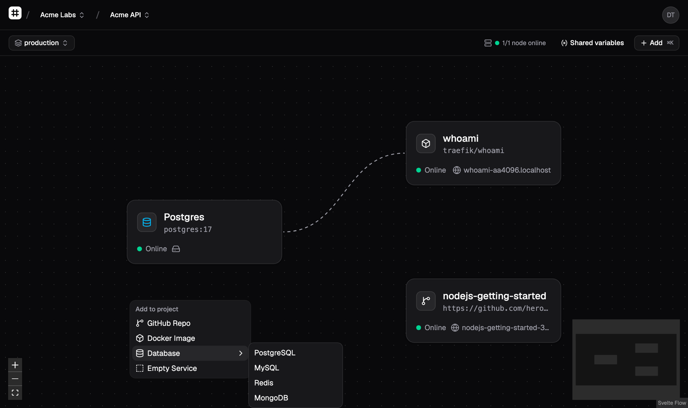
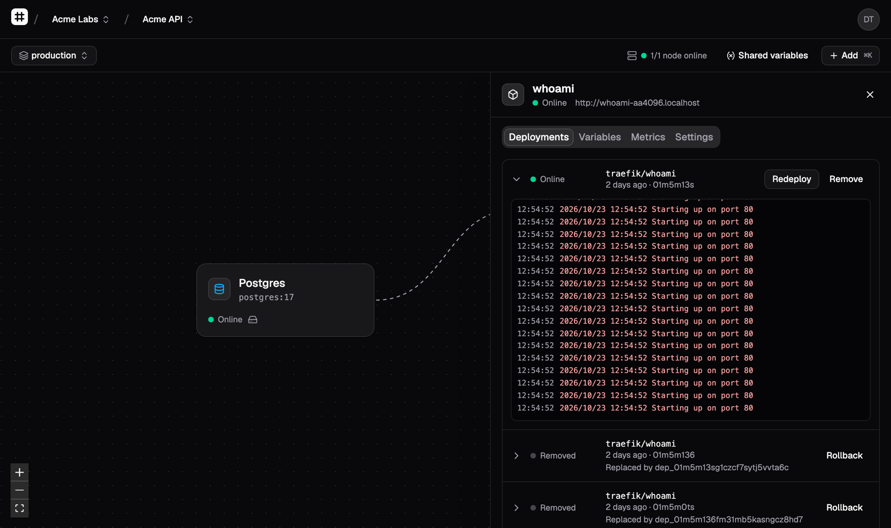
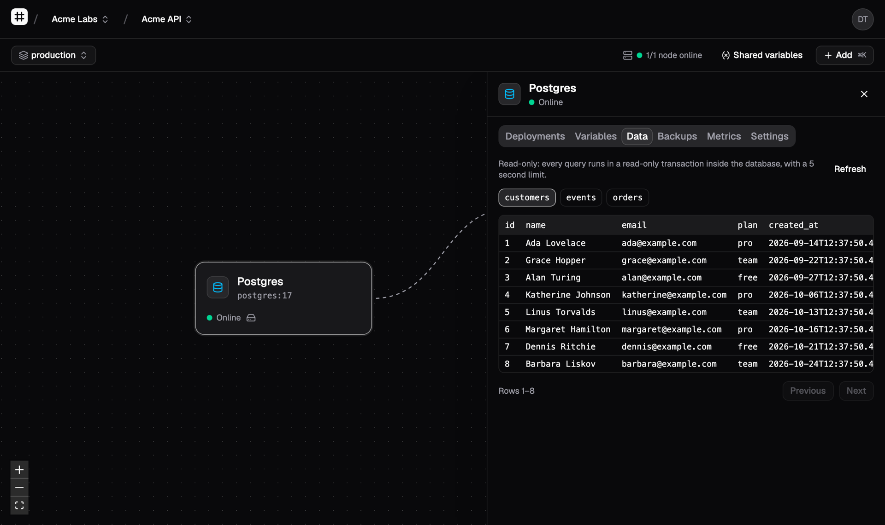
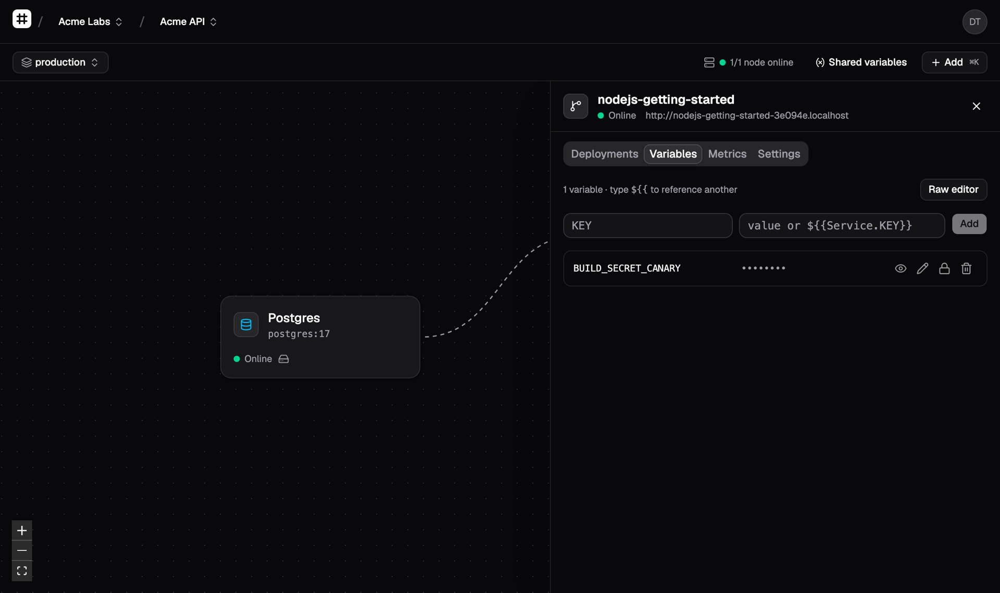
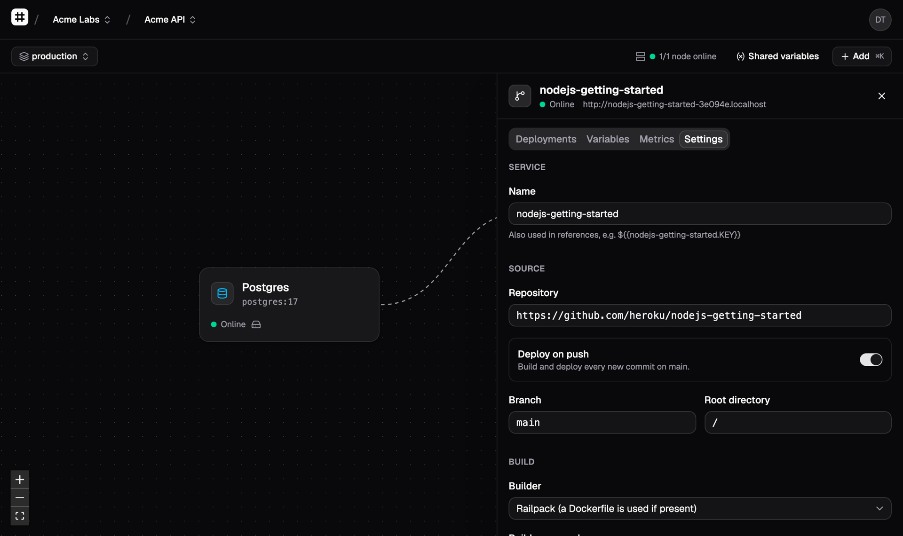
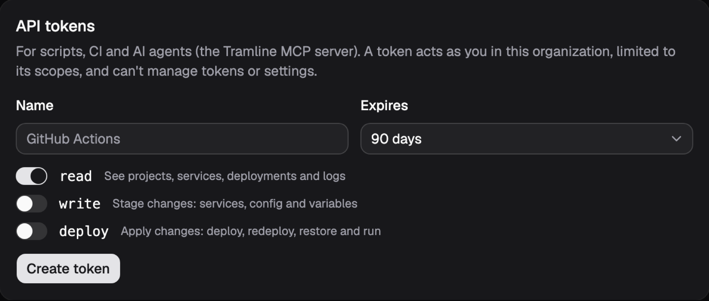

<div align="center">

<picture>
  <source media="(prefers-color-scheme: dark)" srcset="docs/images/logo-dark.svg">
  
</picture>

# Tramline

**The deploy experience you love, on infrastructure you own.**

An open-source, self-hosted platform inspired by [Railway](https://railway.com). Draw your stack on a canvas, push to deploy, and keep your code, secrets and data on hardware you control.

[](https://github.com/JTCorrin/tramline/actions/workflows/ci.yml)
[](https://github.com/JTCorrin/tramline/actions/workflows/security.yml)
[](LICENSE)
[](docs/roadmap.md)
[](CONTRIBUTING.md)

[Why Tramline](#why-tramline) · [Tour](#a-quick-tour) · [Get started](#get-started) · [Roadmap](#roadmap) · [Contributing](#contributing)

<br>



</div>

<br>

## Why Tramline

Platforms like Railway made deploying feel effortless: a canvas instead of YAML, a database in two clicks, a URL on every push. But your code, your customers' data and your secrets live on someone else's machines, and you pay their prices. Tramline brings that experience home.

<table>
<tr>
<td width="33%" valign="top">

### 🔒 Private

Your code, data and secrets never leave your infrastructure. Run it on a laptop, a homelab or your own servers. No telemetry, no vendor lock-in.

</td>
<td width="33%" valign="top">

### 🛡️ Secure by default

The safe choice is the default. Secrets are encrypted at rest, containers are locked down, builds are rootless, every image is scanned for vulnerabilities, and backups are encrypted before they leave the node.

</td>
<td width="33%" valign="top">

### ⚡ Actually pleasant

A real canvas, live logs, zero-downtime deploys, push-to-deploy from GitHub, one-click databases, and a data browser. All the comfort of a hosted platform.

</td>
</tr>
</table>

## A quick tour

<table>
<tr>
<td width="50%" valign="top">

**Deploy anything, watch it live**<br>
Builds from a GitHub repo (no Dockerfile needed, thanks to [Railpack](https://railpack.com)) or any Docker image. Logs stream in as it happens, and every old deployment is a one-click rollback.



</td>
<td width="50%" valign="top">

**Look inside your database**<br>
Postgres, MySQL, Redis and MongoDB in a click, each with a volume and generated credentials. Browse your Postgres tables right in the panel, read-only by construction.



</td>
</tr>
<tr>
<td width="50%" valign="top">

**Variables that connect your stack**<br>
Reference one service from another with `${{Postgres.DATABASE_URL}}` and the canvas draws the connection for you. Values are encrypted, and sealed variables can be written but never read back.



</td>
<td width="50%" valign="top">

**Push to deploy**<br>
Connect GitHub once, then every push to your branch ships. Watch paths skip rebuilds that don't matter, and changes are staged so you review them before they go out.



</td>
</tr>
</table>

### Built for AI agents too

Tramline ships an [MCP](https://modelcontextprotocol.io) server, so Claude, Cursor and other agents can inspect your projects, read logs and deploy. Each agent's access is limited to the scopes of its token, and everything it does is recorded in the audit log.

```bash
claude mcp add tramline --transport http https://tramline.example.com/mcp \
  --header "Authorization: Bearer tl_…"
```

<p align="center"></p>

## Everything in the box today

| Area           | What you get                                                                                                          |
| -------------- | --------------------------------------------------------------------------------------------------------------------- |
| **Canvas**     | Projects as a live canvas of services, environments (with one-click duplication), shared variables and staged changes |
| **Deploys**    | Docker images or builds from Git (Railpack or Dockerfile), zero-downtime swaps, rollbacks, cron services              |
| **Networking** | Automatic URLs through a Caddy ingress, custom domains with verified ownership and automatic HTTPS                    |
| **Data**       | Postgres, MySQL, Redis and MongoDB templates, persistent volumes, a read-only Postgres data browser                   |
| **Backups**    | Encrypted backups to any S3-compatible bucket with restore drills, including Tramline's own database                  |
| **Security**   | Encrypted secrets, hardened containers, rootless builds, Trivy image scanning, CSP, 2FA and passkeys                  |
| **Automation** | REST API, scoped API tokens, an audit log, an MCP server, and GitHub Actions deploys with no stored secrets (OIDC)    |

Want the details? [SECURITY.md](SECURITY.md) explains exactly how each protection works.

## Get started

> [!WARNING]
> Tramline is **pre-alpha**. It works well on a single machine today, but expect rough edges and breaking changes. Please don't run production workloads on it yet.

You'll need Node 24, pnpm 10 and Docker (Docker Desktop, OrbStack or Colima).

```bash
git clone https://github.com/JTCorrin/tramline.git && cd tramline
pnpm install
cp apps/web/.env.example apps/web/.env   # set TRAMLINE_SECRET_KEY: openssl rand -base64 32
pnpm dev
```

Open **http://localhost:5173**, create an account, right-click the canvas and deploy your first service. It'll be live at `http://<service>-<id>.localhost` within moments.

## Roadmap

Tramline is being built in phases. The [full roadmap](docs/roadmap.md) has the details.

- [x] **Foundations**: accounts, organizations, projects
- [x] **Canvas and configuration**: services, variables, environments, staged changes
- [x] **Local deploys**: agent, ingress, live logs, zero-downtime swaps, hardened defaults
- [x] **Builds from source**: rootless BuildKit, Railpack, GitHub App, image scanning
- [x] **Data and networking**: volumes, encrypted backups, custom domains, cron, data browser
- [x] **Agent access**: API tokens, audit log, MCP server, GitHub OIDC, 2FA and passkeys
- [ ] **Multiple machines**: multi-node scheduling, an adapter SDK, Proxmox
- [ ] **Cloud providers**: Hetzner, AWS, GCP and Azure, plus node pools
- [ ] **Price engine**: compare providers and place each workload where it's cheapest
- [ ] **Production ready**: a `tram` CLI, PR environments, a one-line installer

## Contributing

Tramline is built in the open, and it's early enough that your work will shape what it becomes. Whether it's fixing a typo, filing a bug, polishing the UI or writing the Proxmox adapter, contributions of every size are welcome.

- 🐛 **Found a bug or have an idea?** [Open an issue](https://github.com/JTCorrin/tramline/issues).
- 🛠️ **Want to write code?** [CONTRIBUTING.md](CONTRIBUTING.md) covers setup, architecture and tests.
- 🗺️ **Looking for something big?** Phase 6 (multi-node and compute adapters) is up next on the [roadmap](docs/roadmap.md).
- 🔐 **Found a vulnerability?** Please report it privately. See [SECURITY.md](SECURITY.md).

If Tramline looks useful to you, a ⭐ helps other people find it.

## License

Tramline is free software under the [GNU Affero General Public License v3.0](LICENSE). You can use, modify and self-host it freely. If you offer a modified version as a service, you share your changes too.

<div align="center">
<br>
<sub>Built with SvelteKit, Svelte Flow, Docker, BuildKit, Railpack, Caddy and Trivy.</sub>
</div>
